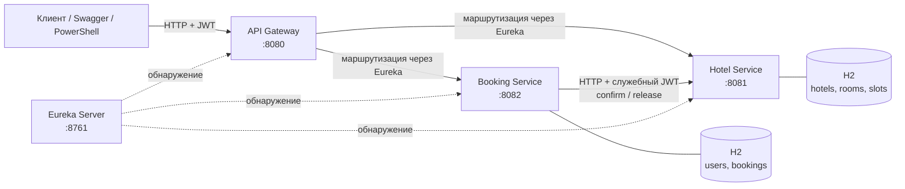
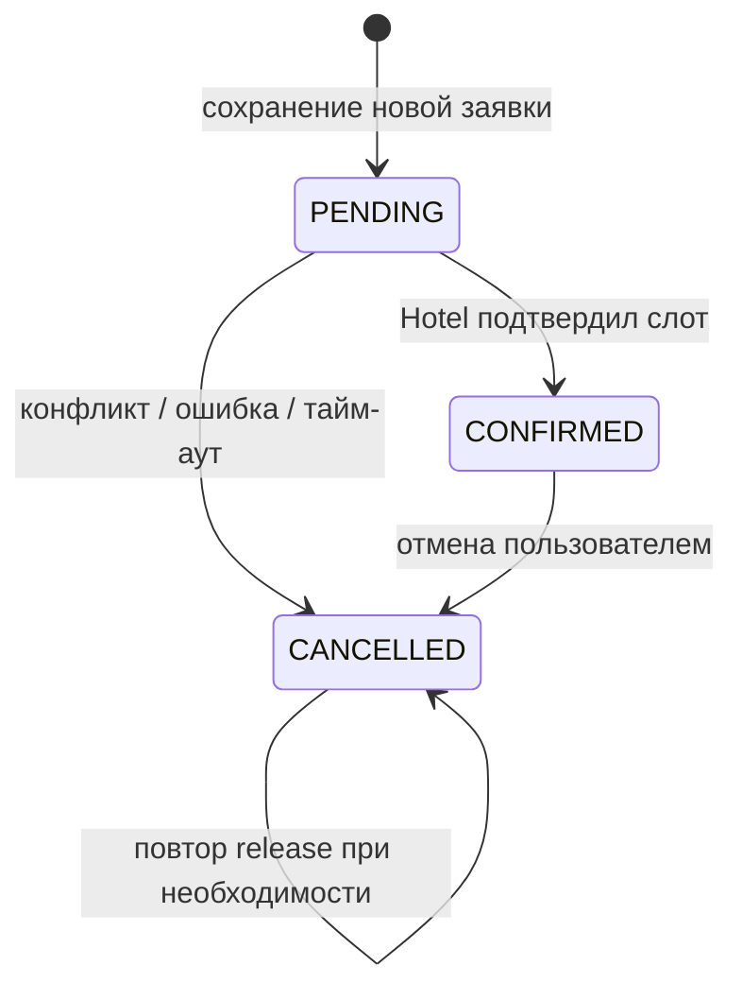

# Hotel Booking — микросервисная система бронирования

Учебный REST API для управления гостиницами, поиска номеров и оформления бронирований. Проект построен на **Java 17**, **Spring Boot 3.5.16** и **Spring Cloud 2025.0.3**. Он состоит из четырёх приложений, взаимодействующих через **Spring Cloud Gateway**, **Eureka** и HTTP.

Основной сценарий — бронирование номера с проверкой занятости в другом сервисе. Для согласования операций используется **Saga с компенсирующими действиями**: запрос можно безопасно повторить, а при сбое система отменяет незавершённую бронь и повторяет освобождение номера после восстановления связи.

## Содержание

- [Возможности](#возможности)
- [Устройство системы](#устройство-системы)
- [Технологии](#технологии)
- [Запуск](#запуск)
- [Демо-данные](#демо-данные)
- [API и Swagger](#api-и-swagger)
- [Пример работы с API](#пример-работы-с-api)
- [Как устроено бронирование](#как-устроено-бронирование)
- [Безопасность и диагностика](#безопасность-и-диагностика)
- [Проверка работоспособности](#проверка-работоспособности)
- [Ограничения реализации](#ограничения-реализации)
- [Структура репозитория](#структура-репозитория)

## Возможности

**Каталог и загрузка гостиниц**

- Создание, просмотр, изменение и удаление гостиниц и номеров.
- Поиск отелей по части названия без учёта регистра.
- Подбор доступных номеров по гостинице, датам заезда/выезда и минимальной вместимости.
- Рекомендации номеров по возрастанию `timesBooked`, при равенстве — по `id`.
- Статистика по гостинице и номеру: частота бронирований, занятые дни, доступные номеро-дни и процент загрузки.

**Бронирования и пользователи**

- Регистрация, вход и JWT-авторизация с ролями `USER` и `ADMIN`.
- Создание брони для выбранного номера или автоматический подбор внутри заданного отеля.
- История бронирований с пагинацией, просмотр и отмена собственных броней.
- Административное управление пользователями.
- Идемпотентность через `X-Request-Id` и запрет пересекающихся подтверждённых бронирований одного номера.

**Надёжность**

- Локальные транзакции в каждом сервисе и Saga между Booking и Hotel.
- Retry, тайм-ауты, Circuit Breaker и отложенная компенсация.
- Логирование ключевых переходов бронирования и ошибок, заголовок `X-Trace-Id`.
- Модульные и интеграционные автотесты, PowerShell smoke-тест.

## Устройство системы



| Компонент | Порт | Ответственность |
|---|---:|---|
| `eureka-server` | `8761` | Реестр и обнаружение экземпляров сервисов. |
| `api-gateway` | `8080` | Единая точка входа, проверка JWT, маршрутизация и `X-Trace-Id`. |
| `hotel-service` | `8081` | Каталог отелей и номеров, занятость, аналитика, подтверждение/освобождение слотов. |
| `booking-service` | `8082` | Учётные записи, авторизация, история, создание и отмена бронирований, Saga. |

Каждый бизнес-сервис владеет **своей H2 in-memory базой данных**. Прямого доступа к таблицам другого микросервиса нет: Booking обращается к Hotel по имени `HOTEL-SERVICE` через Eureka и Spring Cloud LoadBalancer. Вызовы внутренних операций бронирования через Gateway запрещены.

## Технологии

| Область | Используемые решения |
|---|---|
| Язык и сборка | Java 17, Maven, многомодульный проект |
| Основа приложений | Spring Boot 3.5.16, Spring Cloud 2025.0.3 |
| API | Spring Web MVC, Spring Cloud Gateway WebFlux, REST, Springdoc OpenAPI |
| Обнаружение сервисов | Netflix Eureka, Spring Cloud LoadBalancer |
| Хранение | Spring Data JPA, Hibernate, H2 |
| Безопасность | Spring Security, OAuth2 Resource Server, JWT HS256, BCrypt |
| Отказоустойчивость | Spring Retry, Resilience4j CircuitBreaker, `@Scheduled` |
| Проверка | JUnit 5, Spring Boot Test, MockMvc, Mockito, PowerShell |
| Развёртывание | Локальный запуск или Docker Compose |

## Запуск

### Вариант 1. Локально через Maven / IntelliJ IDEA

Потребуются **JDK 17 или новее** и **Maven 3.9+**. Для разработки можно использовать IntelliJ IDEA; проект импортируется по корневому `pom.xml`.

Сначала выполните в корневой папке:

```bash
mvn clean verify
```

Затем запустите четыре приложения **в отдельных терминалах или Run-конфигурациях IntelliJ**. Порядок запуска:

```text
1. eureka-server
2. hotel-service
3. booking-service
4. api-gateway
```

Соответствующие Maven-команды (каждая — в собственном терминале):

```bash
mvn -pl eureka-server spring-boot:run
mvn -pl hotel-service spring-boot:run
mvn -pl booking-service spring-boot:run
mvn -pl api-gateway spring-boot:run
```

Для локальной разработки в конфигурации уже предусмотрены **демонстрационные** JWT-секрет и пароль администратора. Если задаёте собственные значения, они должны совпадать у Gateway, Booking и Hotel. Пример для PowerShell **перед запуском каждого сервиса**:

```powershell
$env:JWT_SECRET = "replace-this-with-a-random-secret-at-least-32-bytes"
$env:ADMIN_PASSWORD = "MyStrongAdminPassword123!"
```

`JWT_SECRET` должен содержать не менее **32 байт UTF-8**. Параметр `ADMIN_PASSWORD` используется при создании демонстрационного администратора во время старта Booking Service.

После запуска доступны:

| Интерфейс | Адрес |
|---|---|
| Eureka Dashboard | http://localhost:8761 |
| API Gateway | http://localhost:8080 |
| Swagger — Hotel Service | http://localhost:8081/swagger-ui.html |
| Swagger — Booking Service | http://localhost:8082/swagger-ui.html |
| Health — Hotel / Booking | http://localhost:8081/actuator/health / http://localhost:8082/actuator/health |

> Swagger открывается на портах самих сервисов, а клиентские запросы рекомендуется направлять через Gateway (`8080`). Для защищённых операций в Swagger используйте кнопку **Authorize** и JWT.

### Вариант 2. Docker Compose

Нужны Docker Desktop / Docker Engine с Compose. В корне проекта создайте `.env` из шаблона и замените демонстрационные секреты своими:

```powershell
Copy-Item .env.example .env
# Отредактируйте JWT_SECRET и ADMIN_PASSWORD в .env

docker compose up --build -d
docker compose ps
```

Для просмотра логов Booking Service:

```bash
docker compose logs -f booking
```

Для остановки:

```bash
docker compose down
```

`.env` не должен попадать в репозиторий. Запуск через Compose предусмотрен проектом, но сам по себе не заменяет функциональное тестирование API.

## Демо-данные

При первом запуске сервисы заполняют базы данными для проверки API. Заполнение можно отключить настройкой `app.seed.enabled=false`.

| Роль | Логин | Пароль при стандартной локальной конфигурации |
|---|---|---|
| `USER` | `demo` | `User123!` |
| `ADMIN` | `admin` | `Admin123!` либо значение `ADMIN_PASSWORD` |

В Hotel Service создаются:

| Гостиница | Номера | Вместимость |
|---|---|---|
| `City Hotel` (`id=1`) | `101`, `102`, `103` | 2, 2, 3 |
| `Park Hotel` (`id=2`) | `201`, `202`, `203` | 2, 2, 4 |

Дополнительно создаются два занятых слота **примерно через 30 дней после старта**: для номеров `101` и `203`. Поэтому сразу после запуска у этих номеров `timesBooked=1`, у остальных — `0`. Даты намеренно рассчитываются динамически.

Все сведения хранятся **в памяти**: при завершении соответствующего приложения его H2-база теряется и на следующем запуске создаётся заново.

## API и Swagger

Ниже приведены **клиентские маршруты через `http://localhost:8080`**. Формат дат — `YYYY-MM-DD`; дата выезда не входит в оплачиваемый интервал `[startDate, endDate)`.

### Пользователи и бронирования — Booking Service

| Метод | Маршрут | Доступ | Назначение |
|---|---|---|---|
| `POST` | `/user/register` | Публичный | Регистрация пользователя с ролью USER, выдача JWT. |
| `POST` | `/user/auth` | Публичный | Вход и получение JWT. |
| `GET` | `/users` | ADMIN | Список пользователей. |
| `POST` | `/user` | ADMIN | Создать пользователя. |
| `PATCH` | `/user/{id}` | ADMIN | Изменить данные пользователя. |
| `DELETE` | `/user/{id}` | ADMIN | Удалить пользователя, если нет истории броней. |
| `POST` | `/booking` | USER / ADMIN | Создать бронирование; обязателен `X-Request-Id`. |
| `GET` | `/booking/{id}` | Владелец / ADMIN | Получить бронирование. |
| `GET` | `/bookings?page=0&size=20` | USER / ADMIN | История **своих** бронирований с пагинацией. |
| `DELETE` | `/booking/{id}` | Владелец / ADMIN | Отменить бронирование. |

Для создания брони передаются `Authorization: Bearer <JWT>` и **отдельный заголовок** `X-Request-Id: <UUID>`.

Выбор конкретного номера:

```json
{
  "startDate": "2027-01-15",
  "endDate": "2027-01-18",
  "roomId": 2,
  "autoSelect": false
}
```

Автоподбор внутри гостиницы:

```json
{
  "startDate": "2027-01-15",
  "endDate": "2027-01-18",
  "hotelId": 1,
  "autoSelect": true
}
```

Для `autoSelect=true` **обязателен `hotelId`**. Сервис выбирает первый из доступных номеров отеля с минимальным `timesBooked` (при равенстве — минимальный `id`).

### Каталог, рекомендации и аналитика — Hotel Service

| Метод | Маршрут | Доступ | Назначение |
|---|---|---|---|
| `GET` | `/api/hotels?name=...` | USER / ADMIN | Список отелей, необязательный поиск по названию. |
| `GET` | `/api/hotels/{id}` | USER / ADMIN | Информация об отеле. |
| `POST` | `/api/hotels` | ADMIN | Создать отель. |
| `PUT` | `/api/hotels/{id}` | ADMIN | Изменить отель. |
| `DELETE` | `/api/hotels/{id}` | ADMIN | Удалить отель без номеров. |
| `GET` | `/api/rooms?startDate=...&endDate=...` | USER / ADMIN | Доступные номера, опционально `hotelId`, `capacity`. |
| `GET` | `/api/rooms/recommend?startDate=...&endDate=...` | USER / ADMIN | Доступные номера, отсортированные по `timesBooked`, затем по `id`. |
| `GET` | `/api/rooms/{id}` | USER / ADMIN | Информация о номере. |
| `POST` | `/api/rooms` | ADMIN | Создать номер. |
| `PUT` | `/api/rooms/{id}` | ADMIN | Изменить номер. |
| `DELETE` | `/api/rooms/{id}` | ADMIN | Удалить номер без активных резервов. |
| `GET` | `/api/hotels/{id}/stats?startDate=...&endDate=...` | ADMIN | Статистика отеля за период. |
| `GET` | `/api/rooms/{id}/stats?startDate=...&endDate=...` | ADMIN | Статистика отдельного номера. |

В `GET /api/rooms` и `GET /api/rooms/recommend` обе даты обязательны; фильтры `hotelId` и `capacity` необязательны. `capacity` означает **минимальную вместимость**.

Метрики отеля: `totalRooms`, `operationalRooms`, `occupiedRooms`, `totalTimesBooked`, `occupiedRoomDays`, `possibleRoomDays`, `occupancyPercent`. Метрики номера: `timesBooked`, `activeReservations`, `occupiedDays`, `occupancyPercent`.

**Служебные операции** `POST /api/rooms/{id}/confirm-availability` и `POST /api/rooms/{id}/release` вызываются Booking Service напрямую с JWT роли `SERVICE`; через Gateway эти пути заблокированы.

## Пример работы с API

### 1. Авторизация и поиск номеров (PowerShell)

Ниже команды для **запущенного приложения**. Даты рассчитываются относительно текущего дня, чтобы пример оставался актуальным.

```powershell
$base = "http://localhost:8080"
$login = Invoke-RestMethod -Method Post -Uri "$base/user/auth" `
  -ContentType "application/json" `
  -Body (@{ username = "demo"; password = "User123!" } | ConvertTo-Json)
$headers = @{ Authorization = "Bearer $($login.token)" }
$start = (Get-Date).AddDays(7).ToString("yyyy-MM-dd")
$end   = (Get-Date).AddDays(10).ToString("yyyy-MM-dd")

$rooms = Invoke-RestMethod -Method Get `
  -Uri "$base/api/rooms/recommend?startDate=$start&endDate=$end&capacity=3" `
  -Headers $headers
$rooms | Format-Table id, hotelId, number, capacity, timesBooked
```

### 2. Создание брони и проверка идемпотентности

```powershell
$requestId = [guid]::NewGuid().ToString()
$bookHeaders = $headers.Clone()
$bookHeaders["X-Request-Id"] = $requestId
$body = @{ startDate = $start; endDate = $end; roomId = 2; autoSelect = $false } | ConvertTo-Json

$booking = Invoke-RestMethod -Method Post -Uri "$base/booking" `
  -Headers $bookHeaders -ContentType "application/json" -Body $body
$booking

# Тот же requestId и то же тело — та же запись, без второго бронирования:
$repeat = Invoke-RestMethod -Method Post -Uri "$base/booking" `
  -Headers $bookHeaders -ContentType "application/json" -Body $body
$booking.id -eq $repeat.id
```

В этом примере номер `2` относится к демонстрационному каталогу. Для проверки на изменённой базе используйте `roomId`, полученный из `/api/rooms`.

### 3. Статистика администратора

```powershell
# Используйте реальный пароль ADMIN_PASSWORD из своей конфигурации.
$adminPassword = "Admin123!"
$admin = Invoke-RestMethod -Method Post -Uri "$base/user/auth" `
  -ContentType "application/json" `
  -Body (@{ username = "admin"; password = $adminPassword } | ConvertTo-Json)
$adminHeaders = @{ Authorization = "Bearer $($admin.token)" }

Invoke-RestMethod -Method Get `
  -Uri "$base/api/hotels/1/stats?startDate=$start&endDate=$end" `
  -Headers $adminHeaders
```

## Как устроено бронирование



1. **Защита от дублей.** Booking проверяет уникальный `X-Request-Id`. Повтор того же запроса возвращает ранее сохранённое бронирование; использование того же ключа с другим содержимым даёт `409 Conflict`.
2. **Локальная фиксация.** Создаётся запись со статусом `PENDING` в БД Booking Service.
3. **Межсервисное подтверждение.** Booking вызывает Hotel по HTTP со служебным JWT. Hotel блокирует строку номера (`PESSIMISTIC_WRITE`), проверяет пересечение дат и создаёт активный слот. Успех переводит бронь в `CONFIRMED`.
4. **Отмена и компенсация.** При конфликте или недоступности Hotel бронь получает `CANCELLED`. Booking вызывает `release`, а Hotel снимает слот и уменьшает счётчик бронирований, если слот был активен.
5. **Восстановление после ошибки.** Если `release` недоступен, у брони остаётся `releasePending=true`. Фоновый планировщик повторяет операцию примерно каждые **10 секунд** до успеха. Также обрабатываются записи `PENDING`, зависшие дольше **60 секунд**.

Для вызовов подтверждения используется до **трёх попыток** с экспоненциальной задержкой (начиная с 200 мс), тайм-аут подключения — **700 мс**, чтения — **1500 мс**. Circuit Breaker ограничивает вызовы при серии ошибок; компенсация выполняется **в обход** Circuit Breaker, чтобы восстановление не блокировалось.

В Hotel Service `release` идемпотентен. Если освобождение пришло раньше запоздалого подтверждения, сохраняется маркер `RELEASED`: поздний `confirm` не создаст активную бронь повторно.

**Автоподбор:** текущая реализация выбирает один наиболее подходящий номер по `(timesBooked, id)`; перебора нескольких кандидатов после конкурентного конфликта нет.

## Безопасность и диагностика

- JWT подписывается алгоритмом **HS256**, срок жизни — **3600 секунд**. Gateway и бизнес-сервисы независимо проверяют подпись токена.
- Роли: `USER`, `ADMIN`, внутренняя `SERVICE`. Только владелец или администратор получает конкретное бронирование; обычный пользователь видит в истории собственные записи.
- Пароли пользователей хранятся в виде хешей **BCrypt**.
- Код `400` — некорректные параметры, `401` — неавторизованный запрос, `403` — недостаточно прав, `409` — конфликт, `503` — ошибка связи с Hotel при подтверждении.
- API-ошибки представлены объектом с полями `code`, `message`, `traceId`, `timestamp`.
- Логи содержат уровень, время, название приложения, `traceId` и события Saga (`PENDING`, `CONFIRMED`, `CANCELLED`, `COMPENSATION_PENDING`, `COMPENSATED`). Например:

```text
WARN  [trace=<request-trace>] bookingId=1 event=CANCELLED reason=...
ERROR [trace=<request-trace>] bookingId=1 event=COMPENSATION_PENDING message=...
INFO  [trace=] bookingId=1 event=COMPENSATED roomId=1
```

Gateway принимает или создаёт `X-Trace-Id` и возвращает его в HTTP-ответе. В Booking Service передача `X-Trace-Id` в исходящих вызовах Hotel Service покрыта отдельными автоматическими тестами. **Полный маршрут Gateway → Booking → Hotel необходимо проверять отдельно**: успешные тесты HTTP-клиента сами по себе не подтверждают сквозную корреляцию логов. События Saga также можно сопоставлять по `bookingId`.

## Тестирование

Проверки разделены на автоматические тесты, сквозной сценарий через API Gateway и ручные проверки отказоустойчивости. **Подробные инструкции, отдельные команды запуска и дополнительные сценарии** приведены в [плане тестирования](docs/test-plan.md).

### Автоматические тесты

Запустите в корне проекта:

```powershell
mvn clean verify
```

На текущей версии выполняются **22 теста**: **6** в `hotel-service` и **16** в `booking-service`. Они проверяют:

- Подтверждение и освобождение слотов, идемпотентность и защиту от запоздалого подтверждения.
- Параллельное бронирование, пересечения дат и сортировку доступных номеров.
- Создание и отмену бронирований, повторный `X-Request-Id`, конфликты и права доступа.
- Сбои Hotel Service: тайм-ауты, `CANCELLED`, отложенную компенсацию и повторную обработку зависшего `PENDING`.
- Поведение автоподбора при конфликте первого кандидата (проверяется существующее ограничение: следующий номер автоматически не выбирается).
- Передачу `X-Trace-Id` в исходящих запросах Booking Service к Hotel Service; это **не заменяет** сквозную проверку Gateway → Booking → Hotel.

Чтобы запустить тесты одного бизнес-сервиса вместе с необходимыми модулями:

```powershell
mvn -pl hotel-service -am test
mvn -pl booking-service -am test
```

### Сквозная проверка через Gateway

Запустите Eureka Server (`8761`), Hotel Service (`8081`), Booking Service (`8082`) и API Gateway (`8080`). Затем выполните:

```powershell
powershell -NoProfile -ExecutionPolicy Bypass -File .\scripts\demo.ps1
```

Скрипт проверяет вход под демонстрационным пользователем, получение номеров, создание брони, повторную доставку запроса с тем же `X-Request-Id`, конфликт `409`, отмену и историю. Успешное завершение обозначается строкой `SMOKE TEST PASSED`.

### Что проверить вручную

- **Saga при отказе:** остановить только Hotel Service, выполнить новое бронирование и проверить `503`, состояние `CANCELLED`, а при неуспешном `release` — `releasePending=true`. После восстановления Hotel Service проверить событие `COMPENSATED` и `releasePending=false`.
- **Безопасность:** проверить ответы без JWT, с JWT пользователя и администратора, в том числе запрет доступа к чужому бронированию.
- **Hotel Service:** через Swagger проверить фильтр `capacity`, сортировку по `timesBooked`, а также статистику отеля и номера за выбранные даты.
- **Трассировка:** передать `X-Trace-Id` при вызове через Gateway и сопоставить заголовки и логи сервисов. Автоматические тесты проверяют исходящие заголовки клиента, а не весь маршрут запроса.

Полная пошаговая инструкция: **[docs/test-plan.md](docs/test-plan.md)**.

## Ограничения реализации

Проект предназначен для учебного стенда, а не для промышленной эксплуатации без доработок:

- **H2 in-memory:** данные не переживают перезапуск соответствующего бизнес-сервиса.
- **Локальные транзакции + Saga:** отсутствует глобальная транзакция между базами, поэтому согласованность достигается компенсирующими действиями.
- **Демонстрационные секреты и пользователи:** подходят только для локального запуска; перед внешним размещением их необходимо заменить.

## Структура репозитория

```text
hotel-booking-microservices/
├── pom.xml
├── compose.yml
├── Dockerfile
├── .env.example
├── eureka-server/
├── api-gateway/
├── hotel-service/
├── booking-service/
├── scripts/
│   └── demo.ps1
└── docs/
    ├── adr.md
    ├── schema.md
    └── test-plan.md
```

Дополнительные материалы:

- [Архитектурные решения и ограничения](docs/adr.md)
- [Схема таблиц](docs/schema.md)
- [Сценарии тестирования](docs/test-plan.md)
